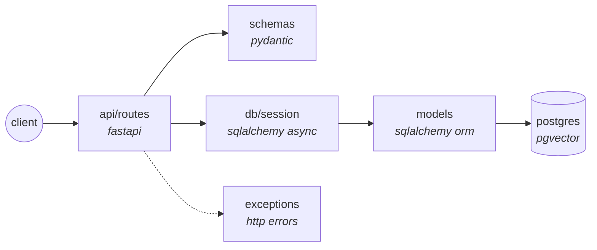
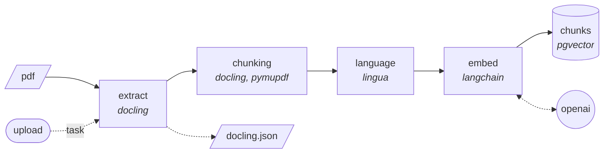

# Backend

FastAPI, SQLAlchemy 2.0 async, `uv`. Runs in Docker. All compose commands are run from the repository root, where `.env` lives.

## What is in here

| Path                  | What it holds                                                                         |
| --------------------- | ------------------------------------------------------------------------------------- |
| `main.py`             | the FastAPI app: five routers, the global `IntegrityError` handler, `/` and `/health` |
| `config.py`           | one pydantic `Settings` object, read from the environment                             |
| `api/routes/`         | 25 handlers in `documents`, `courses`, `editions`, `universities`, `language`         |
| `api/dependencies.py` | `CurrentUserId`, dev only, returns `settings.DEV_USER_ID`                             |
| `db/session.py`       | the async engine, the `SessionLocal` factory and the `SessionDep` dependency          |
| `models/`             | SQLAlchemy 2.0 ORM for the seven tables                                               |
| `schemas/`            | pydantic `Create` / `Update` / `Read`, deliberately separate from the models          |
| `exceptions.py`       | turns Postgres constraint violations into HTTP responses                              |
| `ingestion/`          | the pipeline: `extract.py`, `chunking.py`, `language.py`, `ingest.py`                 |
| `retrieval/`          | `rag.py`, empty for now. Semantic search, keyword search and fusion go here           |

A request never touches the database directly. It goes through a schema for validation and a session for the transaction:



Ingestion runs as a background task, so the upload answers in milliseconds while the work keeps going:



## Run it

```bash
./start_docker.sh gpu               # start, or cpu without an nvidia gpu
docker compose logs -f backend      # follow the log
docker compose down                 # stop, keeps the database volume
```

`gpu` adds `docker-compose.gpu.yaml`, which passes the graphics card to the backend. Without it docling extracts on the cpu, which costs around 30 s per document instead of 2 s. There is no fallback: `gpu` without the nvidia-container-toolkit fails to start.

|           |                                        |
| --------- | -------------------------------------- |
| API       | <http://localhost:5000>                |
| Swagger   | <http://localhost:5000/docs>           |
| Database  | `localhost:5433`, from `POSTGRES_PORT` |
| Streamlit | <http://localhost:8501>                |

The code is bind mounted and uvicorn runs with `--reload`, so code edits need no rebuild.

## Ingest a document

The file has to sit in `data/documents/` at the repository root, which is mounted into the container at `/data/documents`, and a `documents` row has to point at it. Until the upload endpoint exists, insert that row by hand, for example in the Streamlit SQL console, then:

```bash
docker compose exec backend python -m ingestion.ingest -d <document-uuid>
```

The status walk is `pending`, `extracting`, `chunking`, `embedding`, `done`, or `failed` with the reason in `documents.error`.

## After changing dependencies

`uv add` writes to the host `.venv`, but the container has its own at `/app/.venv` as an anonymous volume, which compose carries over on recreate. So a new package needs both a rebuild and a fresh volume:

```bash
docker compose up -d --build --renew-anon-volumes backend
```

Without `--renew-anon-volumes` the stale venv survives and the new package is missing inside the container, while it works fine on the host.

## Local commands

Run from `src/backend`:

```bash
uv sync                              # install into the host's .venv
uv run ruff check . && uv run ruff format .
uv run python -m ingestion.language  # run a module, not a file path
```

Use `-m`, because `python ingestion/language.py` puts `ingestion/` on `sys.path` and then `models` is not importable.

The backend is built to run inside docker compose: the database, the uploaded documents and the model cache all live there, and `DATABASE_URL` and `DOCUMENTS_DIR` are injected with the container's own paths. The host `.venv` is for tooling, so `ruff` and the modules that need no settings.

## Database

Schema lives in `db/init/01_db_setup.sql` and is applied when the volume is created. There are no migrations yet, so a schema change means recreating the volume. Seeding is described in `db/seed/README.md`.
